# Spectre Lab

Lab provides inspection and testing tools for Spectre. Its Spectre 0.4 helper
inspects the **current AgentServer checkpoint** inside a worker and returns a
bounded summary. It does not restore an agent, infer authority from saved data,
or replay external effects.

Standalone tools remain available for verified Instance checkpoint/receipt bundle
playback, comparison, reports and isolated harnesses. Those archive formats are
separate from AgentServer canonical snapshots; neither feature reconstructs
execution that was never recorded.

## Choose the source you want to inspect

The `lab` callback helper reads the calling Server's persisted checkpoint through
its trusted runtime reference. The native `inspect/3` and `trace/3` facades query
the live Server and preserve the consumer's caller identity. Both return bounded
metadata; their source and retained-history coverage remain explicit.



[Diagram source](docs/assets/readme-architecture.mmd).

Use the helper when a flow needs checkpoint metadata. Use the authorized native
facades for application diagnostics; a saved checkpoint can lag the live process.
Offline archive playback is a third, separate API described below.

## Installation

Add the packages to your application:

```elixir
defp deps do
  [
    {:spectre, "~> 0.4.0"},
    {:spectre_ledger, "~> 0.1.0"},
    {:spectre_lab, "~> 0.1.0"}
  ]
end
```

For local development, use `SPECTRE_PATH=../spectre` and
`SPECTRE_LEDGER_PATH=../spectre_ledger` when testing this repository.

The dependency example includes Lab at runtime because the Server below installs
its helper. Applications using only offline testing can instead restrict Lab to
`only: [:dev, :test]`; do not use that restriction when production code installs it.

## Inspect the current checkpoint

```elixir
defmodule MyApp.AI do
  use Spectre.Stack
  install Spectre.Ledger
  install Spectre.Lab
end

defmodule MyApp.SupportServer do
  use Spectre.Server, tools: MyApp.AI

  def handle_flow({:support, :inspect}, _input, ctx),
    do: lab(ctx, {:inspect, :checkpoint}, on_result: :inspection)

  def handle_result(:inspection, {:ok, summary}, ctx) do
    respond(ctx, "Pending: #{summary.pending}; inbox: #{summary.inbox}; outbox: #{summary.outbox}")
  end

  def handle_result(tag, result, ctx), do: super(tag, result, ctx)
end

defmodule MyApp.SupportAgent do
  use Spectre.Agent, stack: MyApp.AI, server: MyApp.SupportServer
  flow :support do
    on :inspect, regex: ~r/^inspect$/i
  end
end

{:ok, store} = Spectre.Ledger.ServerStore.start_link(path: "data/support.ledger")
{:ok, server} = Spectre.Server.start_link(
  agent: MyApp.SupportAgent,
  identity: %{conversation: "conversation-42"},
  gam: [storage: {:disk, "data/support-gam"}],
  checkpoint: {Spectre.Ledger.ServerStore, store, {:support, "conversation-42"}},
  consumer: self())
{:ok, interaction} = Spectre.Server.input(server, "inspect")
```

The runtime supplies the actual checkpoint reference directly to the worker.
Tool input cannot choose another store or conversation. The worker decodes the
snapshot and projects counts, version, sequence and fingerprint presence;
checkpoint bytes and assigns never become its result. `codec_valid: true` proves
codec validity, not authentication or compatibility with the currently running Agent.

## Operational diagnostics and interaction traces

The diagnostics branch targets **Spectre core 0.4**; Lab keeps its independent
package version. The existing summary helper and its result remain unchanged.
For more detail, use the core's versioned, redacted projection:

```elixir
# Metadata from this Server's persisted checkpoint, not a live-state assertion.
lab(ctx, {:inspect, :checkpoint, :operational}, on_result: :diagnostics)

# Correlates only retained facts in this same checkpoint.
lab(ctx, {:inspect, :interaction, interaction_id}, on_result: :trace)
```

Each Skill reads only its own trusted checkpoint reference. Selecting another
mode cannot expose a sibling's state, the root's private data or the shared GAM
ledger. Projections report available active commands, pending intentions and
recovery metadata without returning assigns, input text, prompts, effect
arguments, raw errors or authority credentials. Historical gaps are explicit;
an absent retained event does not mean it never occurred.

The authorized application consumer can inspect the live Server separately:

```elixir
# Call from the same process configured as the Server's consumer.
{:ok, diagnostics} = Spectre.Lab.inspect(server, :operational, limit: 50)
{:ok, trace} = Spectre.Lab.trace(server, interaction_id, limit: 50)
```

These calls delegate directly to the core's authenticated APIs in the caller's
process. They grant no access to an arbitrary process and do not impersonate the
consumer. The trace reports the records actually available, including correlated
GAM facts when permitted by the core, and never fabricates model reasoning.
See the [diagnostic contract](docs/SPECTRE_0_4.md#operational-and-trace-projections).

## Offline archive playback remains separate

```elixir
{:ok, playback} = Spectre.Lab.load(File.read!("test/fixtures/instance-bundle.json"))
revisions = Spectre.Lab.Playback.revisions(playback)
{:ok, frame} = Spectre.Lab.Playback.fetch(playback, List.last(revisions))
```

This is the retained Instance Bundle API, not an AgentServer restart operation.
Bundle verification/playback preserves its existing trusted-artifact boundary:
Foundation decoding may load existing modules named in a checkpoint. Use the
[archive guide](docs/ARCHIVE_PLAYBACK.md) and [security guidance](SECURITY.md).
An explicitly supplied canonical binary is also accepted by the AgentServer
inspection helper for offline input, with its 1 MiB request budget.

## Documentation

- [AgentServer integration, helpers and authority](docs/SPECTRE_0_4.md)
- [Migration from the 0.3 integration](docs/MIGRATING_TO_0_4.md)
- [Standalone and retained runtime reference](docs/ARCHIVE_PLAYBACK.md)
- [Public API](docs/PUBLIC_API.md) and [changelog](CHANGELOG.md)
- [Governed Act Model](https://spectre.guide/en/governed-act-model) and [core tool lifecycle](https://github.com/elchemista/spectre/blob/0.4.0/docs/STACK_TOOLS.md)

## Use inside a reusable Skill

The generated `lab` helper also works in Skill Server callbacks using the same
Stack. Each mount has its own process, state and checkpoint; governed operations
share the root AgentServer's GAM Domain and must satisfy both root operations
and mount `governed:` permissions. Ledger and Lab helpers inspect only the calling Server checkpoint. See the
[core Skill guide](https://github.com/elchemista/spectre/blob/0.4.0/docs/SKILLS.md) for ownership and consent.

## Contributing

Use Elixir 1.19 and OTP 28 with matching core and Ledger checkouts:

```sh
export SPECTRE_PATH=../spectre
export SPECTRE_LEDGER_PATH=../spectre_ledger
mix deps.get
mix test
mix credo
mix dialyzer
mix docs --warnings-as-errors
```

The suite needs no PostgreSQL service. See the [testing guide](docs/TESTING.md)
for isolated test processes, stream fixtures and storage fault injection.

## Examples

The [LiveView playground](https://github.com/elchemista/demo_spectre) demonstrates
Spectre and its packages. [spectre.guide](https://spectre.guide) explains GAM and
provides usage articles. Package versions are independent of Spectre core.
